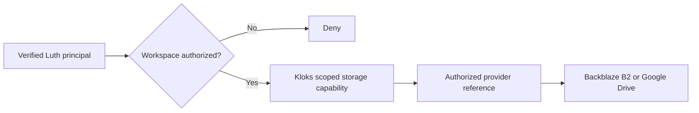

# Canonical user and workspace architecture

## Identity and authority

The app delegates authentication to canonical Luth/Kloks; UI integrates
through Floks. A generated auth screen is not independent OAuth client
registration or a live user session. Do not add a separate password database,
JWT issuer, or browser-stored provider secrets.

## Workspace isolation

Every protected operation must be bound to the verified principal,
the currently selected workspace and the intended application.
Never infer authority solely from a workspace ID, untrusted URL,
discovery beacon, or browser-provided label. Validate ownership and
operation grants at the receiving backend on each sensitive call.

## Cancellation, revocation and failure

Wrong-user or wrong-workspace requests must fail closed. Revoked or
expired sessions and capabilities must not silently return successful
empty data. Frontend agent inspection/action requires explicit consent
bound to the active session and browser window.

## Agent changes

Before editing application features, inspect current workspace authority
and project state. Do not modify Skipo's managed login/workspace pages to
implement product behavior. App-specific UI belongs under the main tabs;
app-owned backend behavior belongs under the services directory.

## Unified Workspace & Storage Architecture

Every storage reference is an authorized workspace-owned resource, not a
globally discoverable account secret. A provider account may be backed by
**Backblaze B2**, **Google Drive** or another approved Kloks/SRKL capability;
these names describe possible providers, not providers automatically
connected by app generation. Never embed a provider key, refresh token or
browser-local privileged credential into a generated app.

The owning application must verify Luth principal, selected workspace and
provider-account grant on each sensitive operation. Storage provider
authentication and object I/O stay behind an authorized backend boundary.

For the application source and binding rules, return to
[the SKIPO APPLICATION CONTRACT](../app-architecture/SKILL.md).
The graph is a trust-boundary description, not proof of a live OAuth
or storage deployment.
